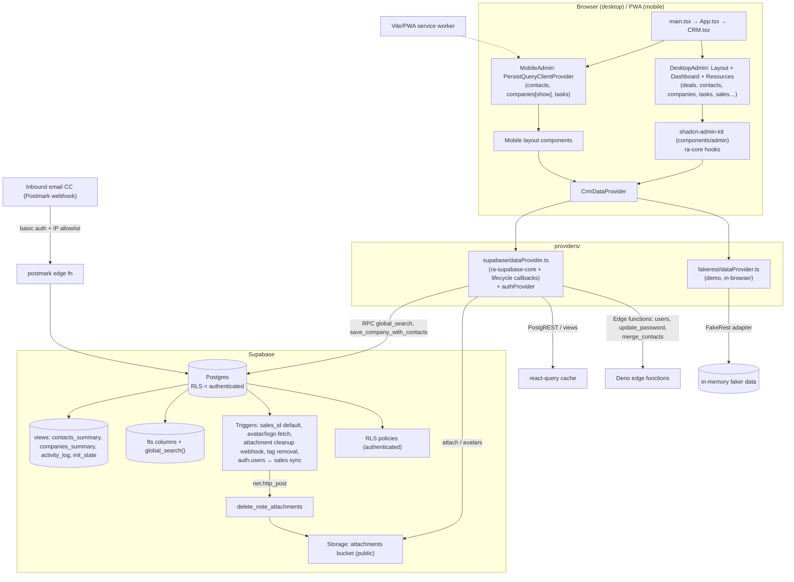

# Atomic CRM — Full Project Analysis

*Analysis date: Nov 2026. Scope: full repository read (config, `src/`, `supabase/`, edge functions, tests, docs, tooling). Everything below is based on the actual code; a few items are explicitly marked "not verified" where I inspected code but could not run it.*

---

## Part 1 — How the project works

### 1.1 What the app is

Atomic CRM is a free, open-source B2B CRM by Marmelab. It manages **contacts, companies, deals (Kanban pipeline), tasks, notes (per contact and per deal), tags and a global activity log**, plus CSV import/export, inbound-email capture (CC a Postmark address → note is attached to the matching contact), a global search, and administrator-only user & branding settings.

Its distinguishing traits:

- **React-admin "headless"**: it uses `ra-core`, not react-admin's Material-UI layer. All screens are custom, validated with `ra-core` hooks (`useListContext`, `useGetList`, `useCanAccess`, `EditBase`, …).
- **shadcn-admin-kit**: the admin chrome (layout, Sidebar, DataTable, form inputs, login, etc.) lives in `src/components/admin/` (~12k LOC) and the shadcn/ui primitives in `src/components/ui/` (~4k LOC). Both are *mutable dependencies* — you edit them in place.
- **Supabase backend**: Postgres + REST + auth + storage + edge functions, with a declarative schema in `supabase/schemas/`.
- **Dual data providers**: Supabase (production) or in-browser **FakeRest** (`make start-demo`) with generated fake data — the demo data provider emulates the PostgREST filter syntax client-side (`src/components/atomic-crm/providers/fakerest/internal/supabaseAdapter.ts`).
- **Mobile PWA**: a separate mobile-first route tree with persisted react-query cache for offline use, and ubiquitous fallback mobile UIs.
- Distributed/customizable as a **shadcn registry** so forks can `npx shadcn add` upstream updates.

#### Tech stack and versions (from `package.json`)

| Piece | Package / version |
|---|---|
| React | `react@19.1`, `react-dom@19.1` |
| Admin core | `ra-core@5.15.2`, `ra-supabase-core@3.5.2`, `ra-data-fakerest@5.15.2`, `ra-i18n-polyglot`, `ra-language-english/french` |
| Router | `react-router@7.17` (override pins `react-router-dom@7.17`) |
| Data fetching | `@tanstack/react-query@5.101` + `react-query-persist-client` + `query-async-storage-persister` (mobile offline) |
| Backend client | `@supabase/supabase-js@2.90` |
| Styling | `tailwindcss@4.1` (v4, CSS-first config in `src/index.css`), `tw-animate-css`, `tailwind-merge` |
| UI kit | shadcn/ui **base-vega** style (`components.json`), built on `@base-ui/react@1.8` (Base UI), `lucide-react` icons |
| DnD | `@hello-pangea/dnd@18` (React 18/19-compatible fork of react-beautiful-dnd) |
| Charts | `@nivo/bar@0.99` |
| Forms | `react-hook-form@7.78`, validation mostly inline + `zod@4.1` where used |
| Misc | `sonner` toasts, `marked` + `dompurify` for note markdown, `react-dropzone` + `papaparse` for CSV import, `jsonexport` export, `date-fns`, `next-themes`, `vite-plugin-pwa@1.3` |
| Build | `vite@8.3.5` (Vite 8 / rolldown options), `typescript@5.8.3` |
| Tests | `vitest@5` in *browser mode* with Playwright/Chromium, `@vitest/browser-react`, Playwright 1.60 e2e, Storybook 10 |
| Node | 24 LTS (`.nvmrc`) |

### 1.2 Project structure

```
atomic-crm/
├── src/
│   ├── App.tsx                 # renders <CRM /> (the whole customization surface)
│   ├── main.tsx                # Vite entry, StrictMode, vite:preloadError reload guard
│   ├── index.css               # Tailwind v4 theme tokens, .dark variant, fonts
│   ├── components/
│   │   ├── admin/              # ~12k LOC shadcn-admin-kit: Admin, List, DataTable,
│   │   │                       # form inputs, login, theme, user menu (MUTABLE)
│   │   ├── ui/                 # ~4k LOC shadcn/ui primitives (MUTABLE)
│   │   ├── atomic-crm/         # the CRM app itself (~32k LOC with tests)
│   │   │   ├── root/           # CRM.tsx, ConfigurationContext, defaultConfiguration
│   │   │   ├── providers/      # supabase/ (prod) & fakerest/ (demo) data+auth providers
│   │   │   ├── layout/         # Layout, Header, CrmSidebar, MobileLayout, PullToRefresh
│   │   │   ├── login/          # StartPage, SignupPage, SSO, forgot/set password
│   │   │   ├── dashboard/      # Dashboard, HotContacts, DealsChart, TasksList, Stepper
│   │   │   ├── contacts/       # list/show/edit/create + import + merge + vCard
│   │   │   ├── companies/      # list (grid/table)/show/edit (+contacts editor)
│   │   │   ├── deals/          # kanban, table view, archived, show/edit/create
│   │   │   ├── tasks/          # due-date buckets, create/edit sheets
│   │   │   ├── notes/          # NotesIterator, attachments, statuses
│   │   │   ├── tags/           # tag CRUD dialogs, colors
│   │   │   ├── activity/       # ActivityLog over activity_log view
│   │   │   ├── sales/          # admin-only user management
│   │   │   ├── settings/       # SettingsPage (configuration), ProfilePage, SettingsTags
│   │   │   ├── search/         # GlobalSearchButton + searchModel (highlight/snippets)
│   │   │   ├── dataImport/     # CSV import machinery (companies/deals)
│   │   │   ├── misc/           # Markdown, RelativeDate, ImportPage, InfinitePagination…
│   │   │   └── types.ts        # all domain types (Contact, Deal, Sale, SearchResult…)
│   │   └── supabase/           # auth pages: forgot-password, set-password, oauth consent
│   ├── hooks/                  # use-mobile, saved-queries, useBulkExport, form contexts
│   └── lib/                    # utils.ts (cn), i18nProvider wrapper, toSlug, etc.
├── supabase/
│   ├── schemas/                # DECLARATIVE SOURCE OF TRUTH (01_tables … 08_search)
│   ├── migrations/             # auto-generated from schemas (do not edit except renames)
│   ├── functions/              # edge functions (users, update_password, merge_contacts,
│   │                           # delete_note_attachments, postmark, mcp)
│   ├── templates/              # auth email HTML (invite/recovery)
│   ├── config.toml             # local supabase (auth signups depend on DB state, storage 50MiB)
│   └── seed.sql
├── e2e/                        # Playwright specs (7 files) + fixtures
├── doc/                        # separate Astro docs site (users + developers docs)
├── public/                     # PWA manifest, icons, favicon
├── scripts/                    # registry generation, ghpages deploy, remote init
├── makefile                    # all workflows (see §1.9)
├── components.json             # shadcn config (base-vega, cssVariables, lucide)
└── registry.json               # generated: maps repo files to the shadcn registry
```

### 1.3 Startup, routing and configuration

**Entry**: `index.html` → `src/main.tsx` (StrictMode; listens for `vite:preloadError` and reloads once after deploys to pick up new chunks) → `src/App.tsx` → `<CRM />` from `src/components/atomic-crm/root/CRM.tsx`.

`<CRM>` is the single customization surface. Props (`CRMProps`): `companySectors`, `currency`, `dealCategories`, `dealPipelineStatuses`, `dealStages`, `noteStatuses` (with colors), `taskTypes`, `title`, light/dark logos, `lightTheme`/`darkTheme`, plus everything shadcn-admin-kit's `<Admin>` accepts (dataProvider, authProvider, i18nProvider, store, dashboard, layout…). Defaults live in `root/defaultConfiguration.ts` (56 sectors, 8 deal stages, pipeline status `["won"]`, 4 note statuses, 9 task types, USD).

Notable mechanics in `CRM.tsx`:

- **Configuration persistence**: prop values are seeded into the ra `store` (`CONFIGURATION_STORE_KEY`) on mount. At login (wrapped `authProvider.login`/`handleCallback`) the app calls `dataProvider.getConfiguration()` reading the `configuration` table (singleton row `id=1`, jsonb payload) and overwrites the store. `useConfigurationLoader.ts` also refreshes it on layout mount (5-min staleTime) — so branding/stages can be edited at runtime from the admin **Settings** page.
- **Responsive admin split**: `useIsMobile()` picks between `DesktopAdmin` and `MobileAdmin` for the *entire route tree*:
  - `DesktopAdmin` → `<Admin layout={Layout} dashboard={Dashboard}>` with React Router `Resource`s: `deals`, `contacts`, `companies`, `contact_notes`, `deal_notes`, `tasks`, `sales`, `tags`, plus custom routes: `/sign-up`, `/confirmation-required`, `/set-password`, `/forgot-password`, `/oauth/consent` (outside layout) and `/profile`, `/settings`, `/import` (`misc/ImportPage.tsx`), `/changelog`.
  - `MobileAdmin` → only `contacts` (with nested `/contacts/:id/notes/:noteId`), `companies` (show only), `tasks`; `MobileDashboard`, `SettingsPageMobile`; wraps everything in `PersistQueryClientProvider` (localStorage persister, 24h gcTime, offlineFirst) — **desktop does not get query persistence**.
- **Telemetry**: anonymous beacon to `atomic-crm-telemetry.marmelab.com` in production unless `disableTelemetry`.

Layout (`layout/Layout.tsx`): `DataImportProvider` → `SidebarProvider` → `CrmSidebar` + `SidebarInset` with sticky `Header` (GlobalSearch, NewRecordButton, theme toggle, refresh, user menu) and an ErrorBoundary + Suspense content area. `MobileLayout.tsx` is the phone equivalent (bottom nav, pull-to-refresh).

### 1.4 Data and backend

#### Tables (`supabase/schemas/01_tables.sql`)

| Table | Purpose / key columns |
|---|---|
| `companies` | name, sector, size, linkedin_url, website (citext), address fields, sales_id, logo jsonb, `lead_date`, email, whatsapp_number, `pitch_point` |
| `contacts` | name, gender, title, background, avatar jsonb, first_seen/last_seen, status, **`tags bigint[]`**, company_id, sales_id, `email_jsonb`/`phone_jsonb` (arrays of `{email|number, type}`), whatsapp_number, `is_primary` (unique partial index per company) |
| `contact_notes` | contact_id, text, date, sales_id, **status** ("cold/warm/hot/in-contract"), `attachments jsonb[]` |
| `deals` | name, company_id, **`contact_ids bigint[]`**, `categories text[]`, stage, amount, `archived_at`, `expected_closing_date`, sales_id, **`index`** (kanban order) |
| `deal_notes` | deal_id, type, text, date, sales_id, attachments jsonb[] |
| `tasks` | contact_id, type, text, due_date, done_date, sales_id |
| `sales` | CRM mirror of `auth.users`: names, email (citext), **`administrator bool`**, user_id uuid (unique), avatar, **`disabled bool`**, `secondary_emails jsonb` |
| `tags` | name, color |
| `configuration` | singleton (`id=1`, `config jsonb`) — runtime config edited by Settings |
| `company_sectors` | BD-backed sector list (value/label) |
| `favicons_excluded_domains` | domains that get no auto favicon |
| `user_invitations` | user_id whitelist enabling sign-up after initialization |

Foreign keys: notes/tasks/deals cascade on parent delete; `contacts.company_id` cascades company deletion to contacts (contacts are deleted when their company is deleted).

#### Views (`03_views.sql`)

- **`contacts_summary`** — contacts + `company_name` + `nb_tasks` (open tasks count) + flattened `email_fts`/`phone_fts` for search. The data provider transparently maps resource `contacts` → this view for `getList`/`getOne` (`providers/supabase/dataProvider.ts`).
- **`companies_summary`** — companies + `nb_deals`, `nb_contacts`.
- **`activity_log`** — `UNION ALL` of 5 "created" events (company/contact/contact_note/deal/deal_note), each row carrying the jsonb record; `security_invoker = on`.
- **`init_state`** — `is_initialized` = sales table non-empty (`security_invoker = off`, deliberately readable pre-login).

#### Functions & triggers

- **`set_sales_id_default`** (trigger on all business tables): untils `sales_id` from `auth.uid()` on insert.
- **`handle_new_user` / `handle_update_user`** (triggers on `auth.users`): sync auth → `sales`. First ever user becomes `administrator = true`; afterwards sign-up raises *Sign up is not allowed* unless the user id is whitelisted in `user_invitations` (invites are created server-side by `users` edge function or via admin scripts/`atomic-crm-api.mdx` docs).
- **`is_admin()`**: RLS helper (security definer) for the `configuration` write policies.
- **`save_company_with_contacts(p_company_id, p_company, p_contacts)`**: one-transaction company + contacts upsert used by CompanyEdit/CompanyCreate — validates one primary contact, inserts/updates each contact, unlinks (never deletes) removed contacts.
- **`merge_contacts(loser_id, winner_id)`**: reassigns tasks/notes, fixes `deals.contact_ids`, merges emails/phones/tags with dedup, COALESCE-picks fields, deletes the loser. Exposed through the `merge_contacts` edge function.
- **Favicon/avatar automation**: `handle_company_saved` sets `logo` from `get_domain_favicon(website)` (uses `favicon.show`, honoring `favicons_excluded_domains`); `handle_contact_saved` sets `avatar` from `get_avatar_for_email` (gravatar → favicon fallback). ⚠️ These run **in synchronous DB triggers that make outbound `http_get` calls** (see Part 2, performance).
- **`lowercase_email_jsonb`**: normalizes emails (trigger ordered before `20_contact_saved`).
- **`cleanup_note_attachments`** (triggers on contact/deal notes update/delete): posts a webhook to the `delete_note_attachments` edge function which garbage-collects storage objects no longer referenced.
- **`handle_tag_deleted`**: removes the deleted tag id from every `contacts.tags` array.
- **Global search (08_search.sql)**: generated immutable `fts` tsvector columns (unaccent + 'simple' tokenizer, prefix matching) + GIN indexes on `companies/contacts/deals/tasks/contact_notes/deal_notes`, plus date btree indexes so the planner can choose between GIN and date-scan strategies. `global_search(query, resources, max_results)` builds a per-branch SQL `UNION ALL` **with the tsquery inlined as a literal** so the planner can see lexeme statistics; each branch caps at ≤200 rows per resource and computes display labels only for the selected rows. Execute is granted to `authenticated` and revoked from `anon`.

#### RLS (`05_policies.sql`)

RLS is enabled on every table, but every policy is essentially `to authenticated using (true)` — **any signed-in user can read, create, update and delete any CRM record**. The only exceptions: `sales` is select-only from the client (writes happen via the `users` edge function with the service key), `configuration` inserts/updates are `is_admin()`-gated, and `user_invitations` has no client grants at all (quickly `revoke`d in `06_grants.sql`). `anon` is granted table privileges in `06_grants.sql` but no anon RLS policy exists, so anon effectively reads nothing (except the `init_state` count).

#### Storage (`07_storage.sql` + init migration)

One bucket, `attachments`, created **public** (`public = true`) with size limit 50MiB. Policies allow select/insert/delete to any `authenticated` user (no per-object ownership restriction). Note attachment and avatar/logo uploads store `path` + `src = getPublicUrl(...)` (see `uploadToBucket` in `providers/supabase/dataProvider.ts`) — permanent public URLs, file names are flat `Math.random()` names.

#### Edge functions (`supabase/functions/`)

| Function | What it does |
|---|---|
| `users` (446 lines) | Create/update CRM users with the service role (POST = create sale + invite; PATCH = update names/email/avatar/disabled/administrator, secondary emails). Auth: Supabase JWT via `AuthMiddleware`; admin verified from the `sales` row (`UserMiddleware`/`getUserSale`) |
| `update_password` | Sends password reset for a given sales id |
| `merge_contacts` | Transactional contact merge (direct Postgres via Kysely) |
| `delete_note_attachments` | Receives old/new note payloads from the DB trigger webhook, deletes orphaned storage objects |
| `postmark` | Inbound email webhook: Basic-auth + expected authorization + IP allowlist (`POSTMARK_WEBHOOK_AUTHORIZED_IPS`); finds/creates a contact from the From address, appends the email as a `contact_notes` row, extracts & uploads attachments, parses forwarded emails |
| `mcp` | An MCP server exposing SQL tools over Postgres (with SQL validation/RLS-aware checks) — used by agents; worth a dedicated security review (not fully audited here) |

#### Data provider (`providers/supabase/dataProvider.ts`)

Built on `ra-supabase-core`'s `supabaseDataProvider` with `sortOrder: "asc,desc.nullslast"` (null-safe sorts everywhere). Customizations:

- Resource redirection: `contacts` ↔ `contacts_summary`, `companies` ↔ `companies_summary`, `activity_log` snake_case column remap.
- `save_company_with_contacts` RPC path for company forms with an embedded contact editor.
- Extra methods: `signUp`, `salesCreate`, `salesUpdate`, `updatePassword`, `unarchiveDeal`, `isInitialized`, `globalSearch` (RPC), `mergeContacts` (edge function), `getConfiguration`/`updateConfiguration`.
- Lifecycle callbacks: full-text search param rewrites (`q` → `@or` of `ilike` filters across configured columns; special-cases `email_fts`/`phone_fts`), deal-category search augmentation, `configuration` logo upload, attachment uploads to the storage bucket (signed-URL check first, else `blob:`/`data:` fetch and upload with random file name), company logo upload.
- `getDataProvider` throws early if `VITE_SUPABASE_URL` / `VITE_SB_PUBLISHABLE_KEY` are missing.

The **FakeRest provider** (`providers/fakerest/`) mirrors all of this in-browser: data generators (faker) produce companies/contacts/deals/tasks/notes/tags/sales, `supabaseAdapter.ts` + `transform*Filter` utilities emulate the PostgREST query syntax (including `@contains`, `@in`, `@or`), the activity view and global search are emulated in TypeScript (`providers/fakerest/search.ts`, reusing `search/searchModel.ts` matching rules).

### 1.5 Authentication, roles, permissions

- **Providers**: email+password via Supabase, or **SSO domain** (`signInWithSSO`), configured in `login/authConfig.ts` (Google, Azure AD, Keycloak, Auth0 supported by Supabase). Login flow pages (`src/components/atomic-crm/login/`, `src/components/supabase/`): StartPage (chooses local vs SSO), SignupPage, ConfirmationRequired, ForgotPassword, SetPassword, and an **OAuth Consent page** (`oauth-consent-page.tsx`) wired to the `ra-supabase-core` OAuth authorization flow (`getAuthorizationDetails/approve/deny` are plumbed into the auth provider).
- **First-run**: `authProvider.checkAuth` consults `init_state`; on an empty instance it signs out anyone and redirects to `/sign-up` where the **first signer-up becomes `administrator`** (`handle_new_user`). Afterwards sign-up is refused unless the id is in `user_invitations` (inserted by the `users` edge function / admin scripts).
- **Roles/permissions**: single role pair — `admin` vs `user` derived from `sales.administrator`, cached in localStorage (`CURRENT_SALE_CACHE_KEY`). `canAccess` (`providers/commons/canAccess.ts`): admin → everything; user → everything except `sales` and `configuration` resources. `ra-core` `<CanAccess>`/`useCanAccess` hide UI (sidebar EmailsSection admin group, user menu items, AccountManagerInput filter vs OnlyMineInput).
- **Sales management** (admin-only, `sales/SalesList.tsx` + edge function): list users, invite new ones (`salesCreate` → edge `users` POST which creates auth user + `user_invitations` + invitation email template `supabase/templates/invite.html`), edit names/avatar/secondary emails/**administrator**/**disabled**; disabling is how you "remove" a user (deletion is avoided to prevent FK data loss). Password reset via `update_password` edge function (Profile page too).
- **`disabled` flag**: written only by the edge function; note the AuthProvider caches `current_sale` in localStorage and only clears on logout — see security notes.

### 1.6 Modules

#### Dashboard (`dashboard/`)
`Dashboard.tsx` does three cheap `getList(…, perPage:1)` count hooks to drive onboarding: no contacts → `DashboardStepper` step 1; no notes → step 2; then a 12-col grid: `HotContacts` (contacts sorted by last_seen, hot status), `DealsChart` (nivo bar of deals by stage grouped by month), `DashboardActivityLog` (ActivityLog page-size ~25), `TasksList` (personal open tasks). `Welcome` card only in demo mode (`VITE_IS_DEMO`). `MobileDashboard.tsx` is a simplified variant. The stepper + tests (`DashboardStepper.test.tsx`) exist; there is no statistic/KPI widget layer.

#### Contacts (`contacts/`)
- **List**: custom list (`ContactList.tsx`, perPage 25) rendering `ContactListContent` rows — avatar (gravatar/favicon), name, title@company, tag chips, open-task count, last activity, and a cold/warm/hot status dot (`misc/Status.tsx`). Filters (`ContactListFilter.tsx`): status, gender, tags, company, `sales_id` (AccountManager for admins / OnlyMine for users), saved queries. Bulk select with **shift+click range selection** and `BulkTagButton` (apply tags to selection); delete via the admin kit bulk menu.
- **Show** (`ContactShow.tsx`, 328 lines): tabs (Details / Notes / Tasks) — Personal info panel (emails/phones jsonb arrays, whatsapp, LinkedIn, vCard export `ExportVCardButton.tsx`), background info, tags editor (`TagsListEdit.tsx`), task list `ContactTasksList`, NotesIterator (markdown, attachments, status selector).
- **Edit/Create**: `ContactEdit.tsx` (desktop form) / `ContactEditSheet.tsx`, `ContactCreateSheet.tsx` (slide-over from anywhere). `ContactInputs.tsx` includes company ReferenceInput (perPage 10), gender, newsletter, tags.
- **Merge** (`ContactMergeButton.tsx`): pick loser+winner → `mergeContacts` edge function; candidate list built by matching avatar/email similarity.
- **Import**: `useContactImport.tsx` maps CSV rows onto contacts (company resolution, tag mapping), CSV sample `contacts_export.csv`.
- Data path: contacts → `contacts_summary` view; list filters via PostgREST operators, `q` → ilike OR over 8 columns.

#### Companies (`companies/`)
- **List**: grid/table modes (`GridList.tsx` + DataTable), `CompanyListFilter`, `CompanyEmpty` with import callout.
- **Show** (`CompanyShow.tsx`): aside overview (logo, sector, size, revenue, address, website), contact list, deals list, ActivityLog scoped `context="company"` (`ActivityLog companyId=…`).
- **Edit** (`CompanyEdit.tsx` + `CompanyContactsInputs.tsx` + `companyForm.ts`): the defining feature — an embedded **contacts editor** (add or update existing contacts per company, one primary) saved atomically through `save_company_with_contacts`. Aside shows counts from `companies_summary`.
- **Create**: same transactional path + favicon auto-logo trigger.

#### Deals (`deals/`)
- **List** (`DealList.tsx`): perPage 100, `pagination={null}` (no pager), filter `archived_at@is null`, sort by `index DESC`. Filters: q, company, categories (`@ov` array operator), AccountManager/OnlyMine. Toolbar: FilterButton, **DealViewToggle** (kanban/table persisted in ra store), Import, Export, Create.
- **Kanban**: `DealListContent.tsx` (see §1.7).
- **Table view**: `DealTableView.tsx` (396 lines) with column sort, edit links.
- **Archived**: `DealArchivedList.tsx` chips; only shown when the list is empty OR always after content.
- **Create/Edit** as sheets (`DealCreate.tsx`/`DealEdit.tsx` triggered by routes `/deals/create`, `/deals/:id`) with `DealInputs` (name, company, contacts multi-select, categories, amount, expected_closing_date, stage, sales).
- **Show**: `DealShow.tsx` (359 lines) — details + deal notes + linked contacts (`deals/ContactList.tsx`).
- **Unarchive** (`dataProvider.unarchiveDeal`): re-indexes the destination column client-side, N update calls.

#### Tasks (`tasks/`)
`TasksListByDueDate.tsx` fetches **perPage 1000** tasks filtered to the identity (or contact), then client-side buckets them with `tasksPredicate.ts` (overdue / today / tomorrow / this week (hidden on ≥Friday) / later), rendered repeated via `TasksListFilter.tsx` (shows 5 per bucket, load-more). Checking done updates `done_date`. `TaskCreateSheet`/`TaskEditSheet` slide-overs for create/edit (types from config), `MobileTasksList` for the phone resource.

#### Notes (`notes/`)
`contact_notes` (with warm/cold/hot/in-contract **status** colored from `noteStatuses`) and `deal_notes` (with `type`). `NotesIterator.tsx` renders chronological notes for a parent with markdown sanitized output (`misc/Markdown.tsx`: marked + DOMPurify), attachments (`AttachmentField.tsx`), `StatusSelector`. `NoteCreateSheet`/`NoteEditSheet`/`NoteInputs(-Mobile)` forms. Mobile has full-page `NoteShowPage` under `/contacts/:id/notes/:noteId`. `foreignKeyMapping.ts`/`noteModel.ts`/`noteStatuses` keep contact/deal notes shared.

#### Tags (`tags/`)
Simple CRUD (`TagDialog`, `TagCreateModal`, `TagEditModal`, `TagForm`, `useCreateTag`, `useTags`), fixed palette `colors.ts`, `TagChip` colors everywhere, settings-level management via `SettingsTags.tsx`. Deleting a tag removes it from all contacts via the `handle_tag_deleted` trigger.

#### Activity log (`activity/`)
`ActivityLog.tsx` → `InfiniteListBase` over the `activity_log` view (perPage 20, infinite scroll), `ActivityLogIterator` renders typed event entries (`ActivityLogContactCreated` etc. in the file), scoped by `companyId` or global; uses `ActivityLogContext` to know which parent type it's in. New note/event components map the view's snake_case columns back to camelCase.

#### Settings / Profile / Sales
- `SettingsPage.tsx` (524 lines, admin-only): edits the `configuration` row — branding (title, light/dark logo with crop via `ImageEditorField`), currency, **company sectors** (backed by `company_sectors` table), **deal stages/pipeline** (with in-use validation `validateItemsInUse` against deals), **deal categories**, **note statuses**, **task types**. Section list mirrors AGENTS.md's customization contract. `SettingsPageMobile.tsx` is a 652-line near-duplicate.
- `ProfilePage.tsx` (423 lines): own identity — names, avatar crop, secondary emails, password change (`update_password`).
- `sales/`: admin user management (see §1.5). `AccountManagerInput.tsx` fetches MAX_DISPLAYED_SALES sales for filters/selects.

#### Import / Export
- **CSV import** (`dataImport/`): `DataImportButton` per resource (contacts/deals/companies) → `DataImportDialog` (react-dropzone + papaparse preview/mapping) → `createEachRow.ts` creates row by row with `fetchRecordsWithCache.ts` caching lookups; progress via `DataImportProgressToast`; reference skeletons in `misc/import-sample.json` and `*_sample.csv`. `useImportFromJson.ts` (804 lines) powers the JSON import for the `/import` page (mainly to load the public demo corpus).
- **Export**: admin kit `ExportButton` (jsonexport CSV) + `hooks/useBulkExport.tsx`; `contacts_export.csv` sample; `hooks/useBulkExport`.

#### Global search (`search/`)
`GlobalSearchButton.tsx` (419 lines): command-palette dialog (cmdk), grouped results with icons, highlights and snippets built by `searchModel.ts` (client-side mirror of the Postgres tokenizer). Calls `dataProvider.globalSearch(q, resources, maxResults)` → `global_search()` RPC. Mobile searches a subset (no deals/deal_notes since mobile has no deals resource). Recent queries stored. Result URL resolution handles tasks (they route to their contact) and notes.

### 1.7 The deals Kanban and drag-and-drop

- Columns = `dealStages` from configuration; the list is fetched (perPage 100, stage-index sort) and bucketed by `stages.ts:getDealsByStage` (deals with an unknown stage fall back to the first stage so nothing disappears).
- `DealListContent.tsx` wraps a `DragDropContext` (`@hello-pangea/dnd`). Each `DealColumn` is a `Droppable` (`droppableId = stage`), each `DealCard` is a `Draggable` priced with the stage total shown in the column header (compact currency).
- **On drop** (`onDragEnd`): an optimistic local reorder (`updateDealStageLocal`) is applied synchronously to the `dealsByStage` state; then `updateDealStage` (`deals/dealUtils.ts`) **persists** with correct fractional-position semantics:
  - same column: fetch that stage's deals (perPage 100), shift indexes ±1 for the affected range, update the dragged deal's index;
  - cross column: fetch both stages, decrease source-column indexes after the source, increase destination indexes at/after the target, update the dragged deal's stage+index.
  - All updates then `Promise.all`-fired as separate `dataProvider.update` calls, followed by `refetch()`.
- handled dropped-outside / same-position cases. `archived_at` stays untouched during normal drags; `DealArchivedList` handles unarchive (which can end up in `unarchiveDeal` N-update path).
- On mobile the deals resource isn't registered at all (`CRM.tsx` MobileAdmin) — the pipeline is desktop-only.

### 1.8 Shared pieces

- **`root/ConfigurationContext.tsx`**: provider + `useConfigurationContext()`; all domain option lists flow from here (empty-guarded fallbacks). Note `deals/stages.ts` and `deals/dealUtils.ts` consume dealStages/currency from it.
- **Types** (`atomic-crm/types.ts`): Contact, Company, Deal, Sale, ContactNote, DealNote, Task, Tag, Activity union, RAFile (attachment), SignUpData, SalesFormData, LabeledValue/DealStage/NoteStatus, SearchResourceName/SearchResult.
- **Hooks**: `hooks/use-mobile.ts` (breakpoint), `useBulkExport`, `useSupportCreateSuggestion`, `saved-queries`, form-iterator context (admin kit); `layout/useRefreshData.ts`.
- **Misc components**: `Markdown`, `RelativeDate` (Intl-based), `Status` (note-status dot), `InfinitePagination`, `ResponsiveFilters`, `CreateSheet`/`EditSheet`, `ImageEditorField` (cropper), `usePapaParse`, `fetchWithTimeout`.
- **consts.ts** (event type constants: COMPANY_CREATED, CONTACT_CREATED, CONTACT_NOTE_CREATED, DEAL_CREATED, DEAL_NOTE_CREATED).
- **i18n**: `providers/commons/englishCrmMessages.ts` + `frenchCrmMessages.ts` with `i18nProvider.ts` (polyglot); locale switcher in header, full FR translations maintained.
- **Theming**: Tailwind v4 CSS variables in `src/index.css` with `.dark` variant, `next-themes` under `admin/theme-provider`, logos switch files by class (`.dark &` pattern in CrmSidebar).

### 1.9 Running, building, testing, deploying

| Task | Command | Notes |
|---|---|---|
| Install | `make install` | npm + local Supabase deps; Node 24, Docker |
| Dev stack | `make start` / `make stop` | Local supabase (54321 REST, 54323 dashboard, 54324 Inbucket) + Vite 5173 |
| Demo mode | `make start-demo` (`npm run dev:demo`) | FakeRest + faker data; `.env.development` sets `VITE_IS_DEMO`; no backend needed |
| Env vars | `.env` / `.env.development` | `VITE_SUPABASE_URL`, `VITE_SB_PUBLISHABLE_KEY` (Supabase publishable key), `VITE_IS_DEMO`, `VITE_INBOUND_EMAIL` (the CC-able address), `VITE_ATTACHMENTS_BUCKET` |
| Unit tests | `make test` | Vitest 5 projects: `app` (browser-mode React tests via Playwright Chromium — needs browsers installed via `make install-playwright-browsers`), `functions` (edge-function tests with jsr→npm aliases), `claude` (hook harness) |
| E2E | `make test-e2e` | Spins an **isolated Supabase instancia** (`.supabase-e2e`, auth port 54341) + Vite 5175 + Playwright UI mode; CI variant `make test-e2e-ci` |
| Typecheck/lint/build | `make typecheck`, `make lint`, `make build` | `tsc && vite build` (PWA plugin, stats.html bundle analysis) |
| Deploy | `supabase-deploy` (`db push`, `functions deploy`) + static hosting | `npm run ghpages:deploy` (base: `./`); `prod-start` serves `dist/` locally; remote init script `scripts/supabase-remote-init.mjs` |
| Registry | `make registry-gen` / `registry-build` | `scripts/generate-registry.mjs` on pre-commit; CI publishes `public/r/atomic-crm.json` to gh-pages |
| Docs | `make doc` | Separate Astro site in `doc/` (users + developers docs) |
| Storybook | `npm run storybook` | Stories for contact/feg/notes components, wrapper at `src/test/StoryWrapper.tsx` |

DB workflow (per AGENTS.md): edit `supabase/schemas/*.sql` → `npx supabase db diff --local -f <name>` → apply → push. Function SQL must match `pg_dump` format to avoid phantom diffs.

### 1.10 Diagram



---

## Part 2 — Review of the current state

*(Findings marked 🔎 are code-level observations I could not verify by running the UI in this session.)*

### 2.1 UI & design

- **Inconsistent loading states.** DealList/Dashboard/DealColumn use `if (isPending) return null` (blank flash then layout jump), ContactListContent uses a single full-width skeleton bar on desktop but 5 nicer per-row skeletons on mobile (`ContactListContent.tsx:70` vs `:188`), TasksListByDueDate waits 1 s and then swaps to a placeholder. There's no shared rule; per-screen ad-hoc choices.
- **Errors are swallowed on desktop lists.** `ContactListContent` returns `null` on error (`ContactListContent.tsx:74`) while the mobile variant shows a retry screen — silent failure with no recovery on desktop.
- **No visible pagination for deals** (`pagination={null}`), and contacts rely on Infinite-style behaviors rather than an explicit pager; the companies list uses the admin kit DataTable with standard pagination — three different list idioms.
- **Table/form consistency**: companies uses the kit's `DataTable`; contacts uses hand-rolled rows; deals has its own `DealTableView`. Column sorting, column toggles and saved sizes only exist where the DataTable does. 🔎 Visual quality of the hand-rolled rows (spacing, hover, first/last rounding) looked decent in code but is not integrated with the kit's DataTable features.
- **Forms are solid** (react-hook-form + shadcn inputs, sheaths/sheet pattern) but **validation is mostly ad-hoc per form** rather than one schema layer (zod is a dependency but barely used — e.g. `SettingsPage` validates with hand-written functions).
- **Empty states** exist (`CompanyEmpty`, `ContactEmpty`, `DealEmpty`, list placeholders) and are good; the ActivityLog and Kanban columns have no labeled empty state when a column is empty (`DealColumn` renders nothing but the droppable — fine visually, minor).
- **Mobile**: genuinely differentiated (separate layouts, bottom nav, touch targets, sheets, pull-to-refresh) — this is the strongest UI area. **But the deal pipeline is missing on mobile entirely** (the mobile admin registers no deals resource; `searchModel.ts` even works around "no deal resource").
- **Dark mode** is a first-class Tailwind v4 `.dark` variant with tokenized colors, plus separate light/dark logos — good. 🔎 I could not visually audit per-component dark regressions.
- **Accessibility gaps**: list-row checkboxes without accessible names (`ContactListContent.tsx:120`), the header/search rely on cmdk behavior; no skip-link despite `id="main-content"` existing in `Layout.tsx`; the archive kanban relies on @hello-pangea's default keyboard drag (works, but no visible focus affordances). No evidence of aria-live for toasts beyond sonner's defaults (fine) or focus management on sheet close.

### 2.2 User experience

- **Speed of common tasks is good**: global search palette, "New record" header button, create-sheets from every list, shift-range bulk select, vCard export, merge with candidates — faster than average for this stack.
- **Search**: global search is recent and well-designed; **list search degrades to `ilike` OR spam** across up to 8 columns (`applyFullTextSearch` in `providers/supabase/dataProvider.ts`) — no trigram/FTS index on the list views (`contacts_summary` only carries derived `email_fts`/`phone_fts` text columns), so big contact tables will feel it (🔎 needs a `EXPLAIN` check on real data to quantify).
- **Pagination/blind spot**: deals shows only the first 100 (no pager, no notice); tasks fetch 1000 rows and bucket client-side — beyond that they silently truncate.
- **Bulk actions**: contacts have select/tag/delete; **companies and deals have no bulk actions**; no bulk stage change on the kanban (multi-select drag).
- **No saved views/private filters** beyond the kit's saved queries hook (wired, 🔎 depth in the contacts filters limited).
- **Missing Salesforce/Zoho/HubSpot-grade features** (not necessarily bugs): opportunity forecast/reports and stage-duration analytics, email templates/sequencing, activity reminders/notifications (no in-app webhook beyond sonner for save toasts), duplicate-detection on contact create (merge exists but is manual), workflows/automation, portal/web forms (the inbound email is the only capture channel), user territory/assignment rules, audit log of *changes* (activity log only tracks creations), calendar/Google sync, quote/CPQ — i.e., it's a strong CLM-lite, not an enterprise pipeline tool. It also lacks account (company) hierarchy, custom fields (documented as "add your own" via code), and record sharing/ownership visibility.
- **Keyboard shortcuts**: the command palette implies some, but there's no shortcut layer (e.g., `g c` for contacts, task quick-add hotkey).
- **Optimistic UX on kanban**: local reorder is optimistic, good — but the post-drop `refetch()` flashes cells; stage changes also don't notify on failure (error thrown into the unhandled promise — see code quality).
- **Onboarding**: `DashboardStepper` covers first-contact/first-note; nice. No sample-data seeding path outside the demo provider.

### 2.3 Code quality

- **Overall**: clean, consistent, small-commit friendly; AGENTS.md is precisely truthful (the app part is ~15k LOC excluding tests; ~32k including them; admin 12k; ui 4k). Types are generally strong (`types.ts`), though the data provider has `any` pockets (`params: any`, `processCompanyLogo(params: any)`).
- **Large/duplicated files**: `misc/useImportFromJson.ts` (804), `fakerest/dataProvider.ts` (721), `SettingsPageMobile.tsx` (652) duplicating `SettingsPage.tsx` (524), `englishCrmMessages.ts` (655)/`frenchCrmMessages.ts` (649), `providers/supabase/dataProvider.ts` (562), `search/GlobalSearchButton.tsx` (419) + 450-line test, `deals/DealTableView.tsx` (396). Desktop/mobile pairs almost always reimplement the same UI (`SettingsPage` vs `SettingsPageMobile`, `NoteInputs` vs `NoteInputsMobile`, `ContactListContent` desktop/mobile, `NotesIterator` vs `NotesIteratorMobile`) — heavy 2× maintenance tax.
- **Deal reorder logic duplicated**: `DealListContent.updateDealStageLocal` and `dealUtils.updateDealStage` reimplement the same bookkeeping; a divergence would corrupt the `deals.index` invariant. There is `dealUtils.test.ts` for the persistence half but not the local half.
- **Kanban persistence is N+1**: a single drag can fire **2 list queries + up to 2N individual UPDATE requests** (`dealUtils.updateDealStage`), and `unarchiveDeal` similarly (`providers/supabase/dataProvider.ts:260`). Fine for demos, bad at scale and racy for concurrent users (two simultaneous drags can interleave index shifts; no DB constraint keeps `index` unique per stage).
- **Errors go to console and vanish**: `console.error` + `throw new Error` in the data provider custom methods; `catch { /* Non-critical */ }` in `CRM.tsx` config fetch; `onDragEnd`'s `updateDealStage().then(refetch)` has no `.catch` — a failed reorder silently desyncs client from server until the next refetch.
- **Tests**: 42 `*.test.*` files run in browser-mode Vitest, 7 Playwright e2e specs + fixtures, Storybook stories for representative screens, plus edge-function tests. Good relative to size, but bulkier untested spots: Settings pages (only `SettingsPage.test.ts` smoke), activity, import JSON, fakerest dataProvider has solid tests including `supabaseAdapter.test.ts` (743 lines) — actually the demo provider is the *most* tested part.
- **Faker v5.5.3 is abandoned** (faker() legacy API) — used only for demo data; replacing with `@faker-js/faker` small but low priority.
- **i18n**: full EN/FR coverage is admirable, but the 655-line message objects encode the alternation into two near-identical files.
- **Markdown/DOMPurify**: sanitized — good.

### 2.4 Performance

- **The favicon/gravatar triggers do synchronous outbound HTTP inside INSERT/UPDATE triggers** (`get_avatar_for_email` → `http_get` to gravatar and/or favicon.show). Every contact write with emails (import! merge! CSV import where avatar isn't specified…) blocks the transaction on external network calls and can be flaky — and an exception path stores the literal string `'ERROR'` in `avatar.src` (`02_functions.sql:81`). This is the biggest DB-time smell in the schema.
- **Global search** is thoughtfully indexed (GIN + date btree + per-branch caps + statistics 10000) — the fastest thing here. List search (ilike × 8 columns) is the opposite: no trigram/GIN on the summary views for those columns.
- **Kanban N+1 updates** (above) and `unarchiveDeal`'s 1000-row fetch + N updates.
- **tasks perPage 1000 / contactAside tags perPage 1000 / SettingsPage perPage 1000** client-side truncation risks.
- **`contacts_summary`/`companies_summary` views** `count(distinct …)` + `group by` on every list page — OK for thousands of rows, will dominate latency at tens of thousands (🔎 untested).
- **Telemetry Image beacon** and external favicons add third-party calls; sheet PWA is well-behaved (manifest, autoUpdate).
- Vite 8 + rolldown, `stats.html` bundle analysis present. 🔎 No bundle-size budget/CI check found.

### 2.5 Security

- **RLS is essentially "anyone signed in can do anything"** on CRM data (companies/contacts/deals/notes/tasks/tags policies are all `using (true)`; Part §1.4). Acceptable for a single-team CRM, but: there's no per-user restriction for the "Only mine" smoke-and-mirrors filter (it's a UI filter, not a data boundary — any user can query someone else's contacts via API), no audit trail, and `sales` emails are readable by any user (fine for a team, surprising otherwise).
- **Storage `attachments` bucket is public** (`insert into storage.buckets … public = true` in the init migration) and every note attachment becomes a **permanent, unguessable-but-public URL** via `getPublicUrl`. Anyone with the link can fetch the file forever (no expiry — signed URLs are only used as an existence probe in `uploadToBucket`). Delete/insert/select policies are `to authenticated using (true)` → **any user can delete any other user's stored file**.
- **`cleanup_note_attachments` HTTP-post trigger** fires with the user's Authorization header — the edge function checks it; OK (I read the trigger side; the function's auth path was not exhaustively audited).
- **Auth "caching"**: `getSale()` result is cached in localStorage until logout (providers/supabase/authProvider.ts) — a **disabled user keeps working until they log out** (the cache isn't invalidated by the `sales.disabled` flag, and RLS won't protect any CRM row since it's all-authenticated anyway).
- **Signup whitelist** (`user_invitations`) is a good control; the `handle_new_user` first-user rule is standard bootstrap behavior but means whoever signs up first on a fresh instance owns the system — documented, but worth a strong warning in deployment docs for anyone cloning to a public staging URL.
- **`postmark` webhook** is well-protected (Basic auth + expected authorization + IP allowlist). `mcp` edge function exposes SQL tools — I did not audit `validateSql`/`rlsPostgres.ts` closely; flag for review before wide deployment.
- **`06_grants.sql`** grants `anon` `ALL` on user tables — harmless while no anon RLS policies exist, but fragile: a future policy accidentally adding `to public` without `authenticated` would leak everything. `init_state` (`security_invoker = off`) intentionally leaks just an initializes count.
- **XSS**: notes markdown passes through DOMPurify; search result labels are React-escaped. No obvious injection vectors in the frontend. SQL injection: edge functions use Kysely parameterized queries; Postgres side builds global_search SQL with format() on a controlled tsquery literal (safe-ish by construction; the query text is passed as a literal after escaping — validated by tests `validateSql.test`).
- **No rate limiting** above what Supabase provides by default; no 2FA/MFA surface.

---

## Part 3 — Suggested improvements (prioritized)

Legend: effort, touching files, S/M/L = small/medium/large.

### Quick wins (S–M effort, immediate value)

1. **Restrict attachment storage access + non-public bucket.**
   *Why*: public URLs forever + any user can delete anyone's files (`supabase/schemas/07_storage.sql`, init migration bucket `public=true`, `uploadToBucket` using `getPublicUrl`).
   *How*: make the bucket private; serve note attachment images through short-lived signed URLs (or a picker endpoint); scope policies to the user's own prefix (`/user_id/…` path convention — requires changing `uploadToBucket` to `userId/filename`).
   *Files*: `uploadToBucket` in `providers/supabase/dataProvider.ts`, `AttachmentField.tsx` rendering, storage policies, migration. **Risk**: any exported/embedded old link breaks; needs a note in docs. Effort M, impact high (security).
2. **Add `.catch` + toast to kanban persistence.**
   *How*: in `DealListContent.onDragEnd`, catch errors from `updateDealStage`, revert the local reorder, `notify()` error (sonner). Also protects a half-failed column state.
   *Files*: `deals/DealListContent.tsx`. Effort S, impact medium.
3. **Fix user disable propagation.**
   *Why*: cached `current_sale` keeps a disabled account fully usable (`providers/supabase/authProvider.ts`).
   *How*: on `checkAuth`, re-read at most the `sales.disabled/administrator` flags (cheap single select) or invalidate the cache timestamp-based (e.g., 5 min), and add an RLS helper won't help until §security item below.
   *Files*: `authProvider.ts` (and server-side `disabled` enforcement via edge/DB too). Effort S, impact medium.
4. **Escape-from-null loading polish for the kanban & lists: reuse skeleton shells.**
   *How*: introduce one `ListSkeleton` (per-row skeletons like the mobile variant) for DealList, ContactList desktop, Dashboard widgets instead of `return null`.
   *Files*: `deals/DealListContent.tsx`, `contacts/ContactListContent.tsx`, `dashboard/*`. Effort S, impact low–medium (perceived speed).
5. **Replace single-use `any` types in the data provider.**
   *Files*: `providers/supabase/dataProvider.ts`, `providers/commons/*`. Effort S, impact low (type safety), zero risk.
6. **Fork faker → `@faker-js/faker`.** *Files*: `providers/fakerest/dataGenerator/*`. Effort S, impact low.
7. **A11y quick pass**: aria-labels on list checkboxes, a skip link in `Layout.tsx` (target `#main-content`), focus-visible styling for kanban cards.
   *Files*: `ContactListContent.tsx`, `layout/Layout.tsx`, `deals/DealCard.tsx`. Effort S, impact medium for accessibility.
8. **Deal "archived" indicator on empty columns** and empty-column drop affordance (dashed target when empty).
   *Files*: `deals/DealColumn.tsx`. Effort S, impact low.

### UI redesign candidates

9. **Unify the list/table idiom.** Choose DataTable (kit) as the canonical list control and move contacts/deals-table onto it, keeping row avatar+tags via custom `field` slots. Gains: consistent sort/column toggles/bulk toolbar, one place to fix loading/empty.
   *Files*: `contacts/ContactList.tsx`+`ContactListContent.tsx`, `deals/DealTableView.tsx`, `admin/data-table.tsx`. Effort M/L, impact high; **risk**: regression in the shift-select range behavior & mobile variants — keep behind tests.
10. **Consolidate desktop/mobile duplicates.** Split `SettingsPageMobile` into the same sections as `SettingsPage` sharing the section definitions; same treatment for Note/Task inputs and the contact rows. Cutting ~800 LOC of duplication is realistic.
    *Files*: `settings/*`, `notes/*`, `tasks/*`, `contacts/*`. Effort L (incremental), impact medium (maintenance).
11. **Form validation layer.** Introduce one zod schema per module (contact, company, deal, task) with translated messages, shared with import mappers.
    *Files*: `types.ts` + form components + `dataImport/*`. Effort M, impact medium.
12. **Kanban visual fit**: column scroll, drag ghost styling, WIP counts/badges, "close-won/won archive" affordance in header (pipeline statuses exist in config but aren't surfaced visually beyond kanban column omission — 🔎 confirmed `dealPipelineStatuses` used to exclude the column in DefaultConfiguration; double-check the column omission code in `stages.ts`).

### New features

13. **Deals on mobile** (list + stage change via select, not drag): the infra exists (custom route tree), only the resource registration blocks it.
    *Files*: `root/CRM.tsx`, a `MobileDealList.tsx`, `searchModel.ts` mobile resource list. Effort M, impact high.
14. **Bulk stage change + bulk delete on deals/companies** using the kit's bulk toolbar.
    *Files*: `deals/*`, `companies/*`. Effort S/M, impact medium.
15. **Reports view** (deals by stage over time, activities per rep, won/lost reasons) — the schema already tracks `created_at`, `stage`, `amount`; start with 3 charts on a `/reports` route reusing nivo.
    *Files*: new `reports/` module. Effort L, impact high (completeness vs competitors).
16. **Duplicate-detection on contact create/import** (name+email fuzzy match with merge shortcut to the existing merge flow).
    *Files*: `contacts/*`, `dataImport/useContactImport.tsx`, `merge_contacts` edge fn. Effort M, impact high for data quality.
17. **Keyboard shortcut layer** (`cmd+k` exists; add `n` new record, `/` search, `g d/c/t` navigation) via a small `useHotkeys`.
    *Files*: `layout/Header.tsx`, new hook. Effort S/M, impact medium.
18. **Activity log: record stage updates/contact edits**, not just creations (new event types in the view union + a `activity_log_events` writer or a trigger on deals updated columns).
    *Files*: `supabase/schemas/03_views.sql` (+ migration), `activity/*`. Effort M/L, impact high (compliance/trust).

### Code & performance

19. **Replace kanban N+1 with one SQL RPC** (`reorder_deals(stage_source, stage_dest, moved_id, new_index)`) doing the index shifts server-side atomically. Cures latency, races, and removes duplicated client bookkeeping (keep `updateDealStageLocal` for optimism).
   *Files*: new schema function + migration, `deals/dealUtils.ts`, `providers/supabase/dataProvider.ts` (new method), fakerest emulation. Effort M, impact high (correctness + perf). **Risk**: must keep fakerest parity and e2e green (`e2e/*`).
20. **Index the ilike paths**: add `pg_trgm` GIN indexes on `companies.name/phone…`, `contacts_summary` name/title/email/phone (or switch list search to `fts` columns with a `websearch_to_tsquery` variant).
    *Files*: `supabase/schemas/08_search.sql` (+03 views for searchable text). Effort S/M, impact high at scale.
21. **Dethunk the favicon/gravatar triggers** (biggest DB-side risk). Move avatar/logo fetch into the `users`-style edge functions or a background job (`pg_cron`/webhook): write now, enrich later; or at minimum drop the synchronous gravatar HTTP and keep a deferrable trigger.
    *Files*: `supabase/schemas/02_functions.sql`, `04_triggers.sql`, and a migration; plus the CSV import path which currently waits on them. Effort M, impact high (write latency + resilience). **Risk**: nuance — contacts created via `save_company_with_contacts` and merge rely on the trigger; adjust parity tests.
22. **Server-side filter/pagination for tasks** (due-date buckets as Postgres conditions with a per-bucket `count`), removing `perPage: 1000` reads.
    *Files*: `tasks/TasksListByDueDate.tsx`, `providers/*` (added `getMany`-style helper or view). Effort M, impact medium at scale; low priority <1000 tasks.
23. **Telemetry/console cleanliness**: replace `console.error` with `notify` on data-provider custom methods; keep console only for debug paths.
    *Files*: `providers/supabase/*`. Effort S, impact medium (UX reliability).
24. **Dead `q`-filter path for deals categories**: `searchDealCategories` shows the search combo of category labels — 🔎 audit code duplication there (`searchDealCategories.ts` re-queries companies? Actually queries deals) and fold into the `@ov` filter.

### Security

25. **Tighten RLS to ownership/role semantics** (with a migration + tests): e.g., every user can read; writes require `sales_id = current sale id` OR `is_admin()`; notes owned by their sales id; add an audit log. Keep an "open team mode" flag in `configuration` for existing deployments.
    *Files*: `supabase/schemas/05_policies.sql` (+02 helpers), data provider (pass sales_id explicitly), fakerest adapter. Effort L, impact high, **highest product risk** — decide consciously; until then document that "team = single tenant, any member sees everything explicitly in docs (currently only implicit)."
26. **`anon` grant sweep**: revoke anon grants on CRM tables (they serve no anon policies), keeping only `init_state`; prevents future leak-by-policy accident.
    *Files*: `supabase/schemas/06_grants.sql`. Effort S, impact medium.
27. **Rate-limit & harden auth surfaces**: enable Supabase rate limits on auth endpoints; add MFA surface (Supabase supports it) on ProfilePage.
    *Files*: config + `settings/ProfilePage.tsx`. Effort S/M, impact medium.
28. **Review `mcp` edge function** before you rely on it in any production tenant (SQL validation depth, per-call RBAC).
    *Files*: `supabase/functions/mcp/*`. Effort S (audit), impact unknown until audited.

### Recommended order

1. **Security quick wins first** (attachment storage, `anon` grants sweep, `disabled` auth cache fix) — small diffs, real risk reduction. *(Items 1, 3, 26.)*
2. **Kanban atomicity** (`reorder_deals` RPC + error handling) — the most-used interactive surface and the most fragile persistence path today. *(Items 2, 19.)*
3. **DB write latency + list search** (favicon/gravatar trigger deferral, trigram/FTS on list search). *(Items 20, 21.)*
4. **UX fillers**: mobile deals, bulk actions, keyboard shortcuts, empty/loading skeletons, a11y. *(Items 4, 7, 8, 13, 14, 17.)*
5. **Structural refactors** (DataTable unification, mobile/desktop consolidation, zod validation) — cadence these with feature freezes so visual regression tests can catch breakage. *(Items 9, 10, 11.)*
6. **Growth features** (reports, duplicate detection, richer activity log), then, consciously, the **RLS/ownership model** once the product decides how private a CRM it wants to be. *(Items 15, 16, 18, 25.)*

---

### Things I could not verify in this session

- Anything requiring a running UI (visual spacing/dark-mode regressions, perceived jank, kanban feel) — marked 🔎 where relevant.
- `EXPLAIN`-level query plans for the summary views and list `ilike` filters at scale.
- `supabase/functions/mcp` SQL validation depth; `users` edge function complete flow (I read the authorization middleware and main handlers, not every branch).
- Bundle size behavior and PWA offline behavior in real device conditions.
